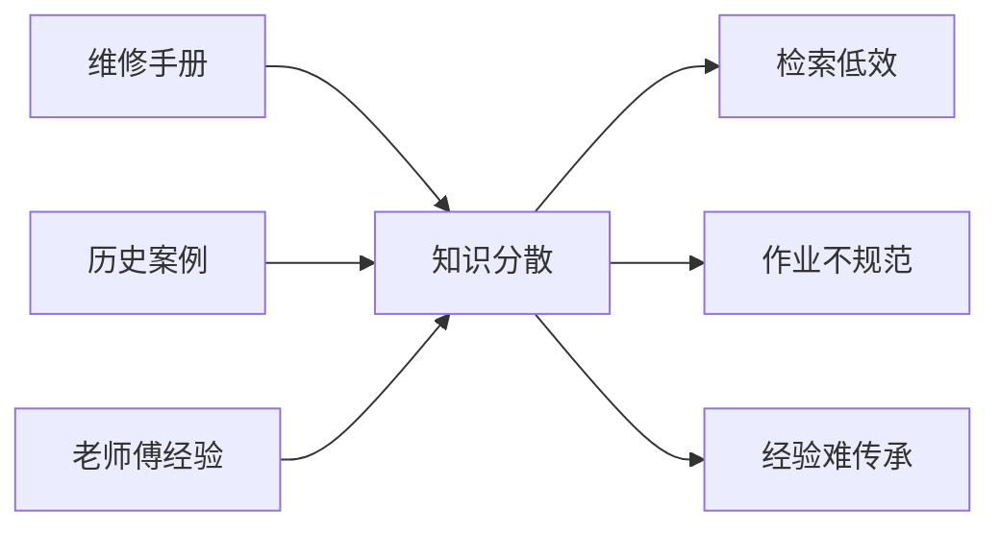
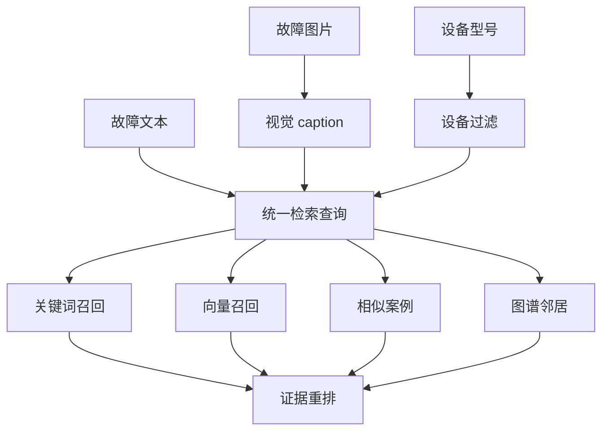
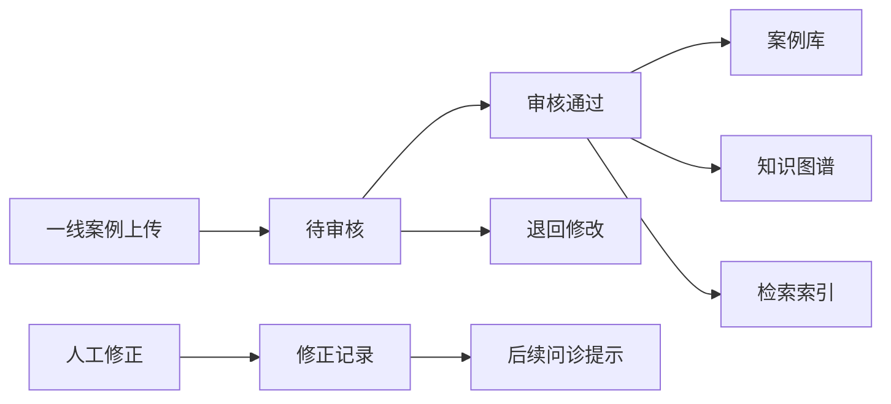

# 答辩 PPT 大纲

建议页数：12-14 页  
建议时长：8-10 分钟展示，2-4 分钟问答  
主线：从检修痛点出发，证明系统不是聊天机器人，而是可追溯、可审核、可部署、可评测的检修作业辅助平台。

## 1. 封面

标题：基于多模态大模型技术的设备检修知识检索与作业辅助系统

副标题：面向电机、离心泵、轴承的标准化检修智能助手

展示内容：

- 赛题：A1
- 团队成员与指导老师
- 学校/学院
- 日期

## 2. 赛题理解与核心痛点

核心观点：

- 检修知识分散在手册、案例、经验和图表中。
- 一线检修检索效率低，作业步骤依赖经验。
- 安全合规项容易遗漏，例如断电挂牌、PPE、泄压降温、防误启动。
- 经验沉淀困难，案例审核和复用缺闭环。

建议图示：



## 3. 作品定位

一句话定位：

系统不是“维修问答机器人”，而是“设备检修作业辅助系统”。

核心链路：

```text
设备型号 / 故障文本 / 故障图片
→ 多模态知识检索
→ 手册与案例证据
→ 故障判断
→ 标准化 SOP
→ 合规校验
→ 人工审核
→ 知识图谱沉淀
```

强调边界：

- 聚焦电机、离心泵、轴承三类设备。
- 优先解决 A1 要求中的可落地性和可追溯性。

## 4. 系统总体架构

建议放 `docs/TECHNICAL_ARCHITECTURE.md` 中的总体架构图。

讲述重点：

- 前端：Vue 3 PC Web 工作台。
- 后端：FastAPI 编排服务。
- 数据：SQLite、手册 chunk、案例库、评测集、知识图谱。
- 模型：Codex/SpatialAI 负责文本和视觉，OpenRouter 负责 embedding。
- 部署：LoongArch 只跑应用、索引和编排服务，不本地跑大模型。

## 5. 数据资产与来源追溯

展示指标：

| 数据 | 数量 |
|---|---:|
| 公开来源 | 9 |
| 文档数 | 13 |
| 手册 chunk | 1108 |
| 带来源 URL 的 chunk | 1092 |
| 团队自建案例 | 125 |
| 团队自建评测题 | 104 |
| OpenRouter embedding 向量 | 1233 |

讲述重点：

- 来源覆盖 ABB/WEG/Grundfos/SKF。
- 公开 PDF 不放入提交包，只保留 URL、页码、许可说明和 sidecar metadata。
- 所有回答必须展示引用证据。

## 6. 多模态检索设计

建议图示：



讲述重点：

- 图片不是直接让模型猜，而是转为结构化描述参与检索。
- 设备类型和型号过滤降低误召回。
- 引用优先来自真实手册，案例作为经验补充。

## 7. 标准作业与合规校验

展示输出结构：

- 故障判断
- 可能原因
- 检查前安全确认
- 工具备件
- 步骤化 SOP
- 合规提醒
- 验收标准
- 引用来源
- 风险等级

合规项：

- LOTO / 断电挂牌
- PPE
- 防误启动
- 泄压/降温
- 工具备件
- 复测验收
- 禁止事项

## 8. 知识沉淀闭环

建议图示：



讲述重点：

- 未审核案例不直接污染知识库。
- 审核通过后同步进入案例库、图谱和索引。
- 人工修正模型输出结果可被后续相似问诊复用。

## 9. 多 Agent 编排

展示表格：

| Agent | 职责 | 路由 |
|---|---|---|
| 检索 Agent | 手册、图片、案例、图谱召回 | 本地 + OpenRouter |
| 视觉 Agent | 图片 caption | Codex/SpatialAI |
| 诊断 Agent | 故障判断和原因分析 | Codex/SpatialAI |
| SOP Agent | 作业步骤与验收标准 | 规则 + Codex/SpatialAI |
| 合规 Agent | 安全规则和模型复核 | 规则 + Codex/SpatialAI |
| 知识更新 Agent | 审核后写入案例、图谱、索引 | 本地 |

强调：

- Agent 分工不是堆概念，而是对应 A1 的每个功能要求。

## 10. 评测与对比实验

展示指标：

- Recall@5
- 引用覆盖率
- SOP 完整度
- 幻觉率
- 安全漏检率

对比组：

- 无 RAG
- 文本 RAG
- 多模态 RAG
- 本系统

讲述重点：

- 评测面板可运行。
- readiness audit 会阻止把未审核评测误当成正式结果。
- 正式答辩前机械队友审核后重新跑完整评测。

## 11. 部署与提交安全

展示内容：

- LoongArch + 银河麒麟部署：FastAPI、Vue 静态资源、SQLite、索引。
- 云端模型：文本、视觉、embedding 通过中转 API。
- 提交包排除 `.env.local`、数据库、原始 PDF、虚拟环境和缓存。
- `scripts/audit_readiness.py` 自动检查提交包和阻塞项。

当前提交包：

```text
dist/a1-maintenance-assistant-submission-20260510-readiness-final.zip
entries=67
forbidden=0
```

## 12. 系统演示

按 `docs/DEMO_SCRIPT.md` 展示五条链路：

1. 文本故障问诊。
2. 图片故障检索。
3. 标准化作业与合规拦截。
4. 案例上传、审核、知识图谱更新。
5. 量化评测与 readiness audit。

建议现场先演示文本问诊，再演示案例审核和图谱更新；图片上传作为第二重点，避免网络波动影响节奏。

## 13. 创新点总结

六个亮点：

- 领域垂直：电机、泵、轴承。
- 证据可追溯：手册页码、来源 URL、许可说明。
- 多模态检索：文本、型号、图片 caption、向量检索和图谱扩展。
- 机械专业 SOP：步骤、工具、安全、验收。
- 知识沉淀闭环：案例审核、图谱更新、人工修正。
- 量化评测与审计：指标面板、提交包安全、ready gate。

## 14. 当前状态与后续工作

已完成：

- Web 系统、检索、SOP、合规、案例、图谱、评测、模型路由。
- 9 份公开来源、1108 条手册 chunk、1233 条远程 embedding。
- 提交包、技术架构、测试报告、演示脚本、readiness audit。

待完成：

- 机械专业队友审核并回写至少 100 条案例和 100 条评测题。
- LoongArch + 银河麒麟实机验证和录屏。
- 正式提交前确认公开 PDF 的展示与引用方式。

收束话术：

本系统已经把多模态大模型能力落到设备检修的真实工作流中：能查证据、能出 SOP、能做安全校验、能沉淀案例、能量化评测，并能在国产架构环境中以轻量方式部署。
