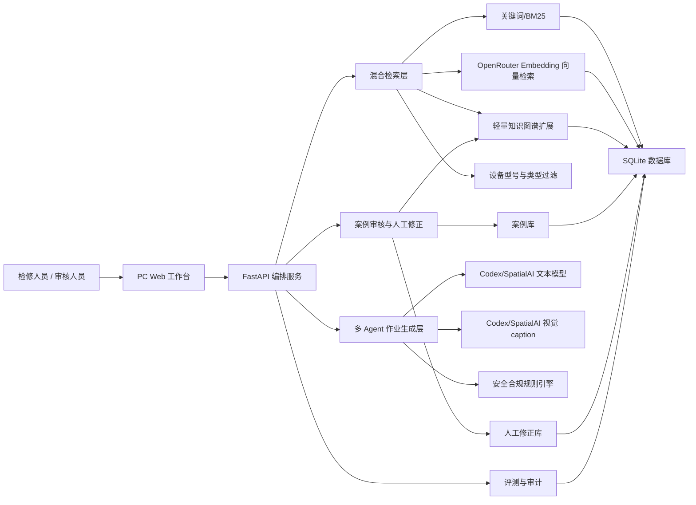
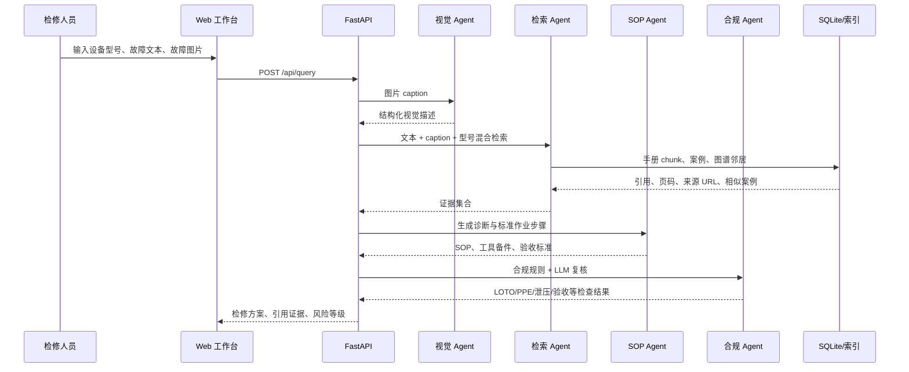
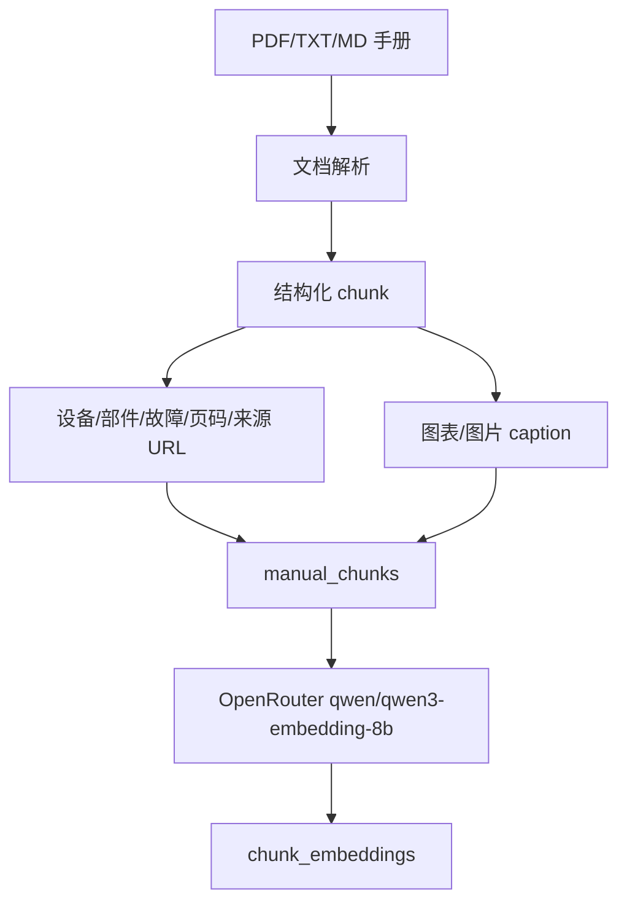
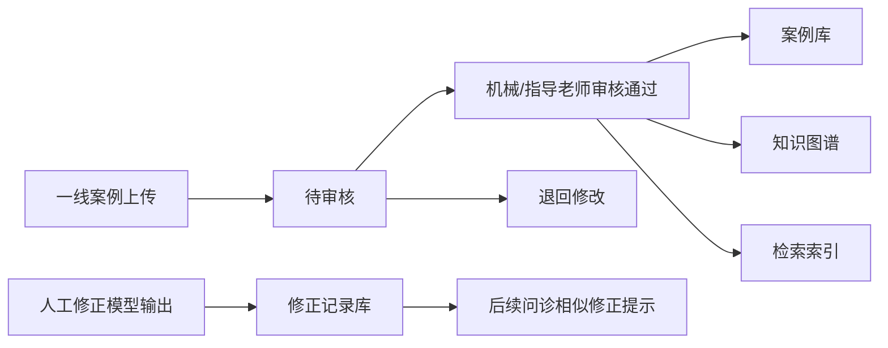

# 技术架构说明

本系统面向中国软件杯 A1 赛题“基于多模态大模型技术的设备检修知识检索与作业系统”，定位为设备检修作业辅助平台，而不是泛化维修聊天机器人。核心目标是把电机、离心泵、轴承三类设备的检修资料、故障输入、标准作业、合规校验、案例沉淀和评测闭环统一起来。

2026-05-11 更新：系统新增多模态图片评测 ready gate。`data/image_eval/fault_image_eval_manifest.csv` 定义 30 张故障图片的设备、故障类型、视觉证据、期望检索关键词和安全关键词；`scripts/image_eval_status.py` 与 `/api/image-eval/status` 负责统计真实图片是否就位、是否完成机械审核，并把缺口纳入最终审计。

## 总体架构

## 核心链路

## 数据层

数据资产分为四类：

- 公开维修资料：9 份 ABB/WEG/Grundfos/SKF 公开厂商 PDF，来源清单在 `data/sources/public_manual_sources.json`。
- 结构化手册 chunk：当前 1108 条手册 chunk，其中 1092 条带来源 URL，可追溯到原始 PDF。
- 团队自建案例与评测题：当前 125 条案例、104 条评测题，已导出机械审核 CSV。
- 运行时知识资产：知识图谱节点/边、人工修正记录、向量索引、评测运行结果。

公开 PDF 不进入提交包，提交包只保留 URL、sidecar metadata 和数据来源说明，降低再分发授权风险。

## 文档解析与索引

设计取舍：

- 部署侧只加载结构化结果和索引，重型解析可在开发机完成。
- SQLite 足够支撑答辩演示、审计和 LoongArch 轻量部署。
- 检索结果必须展示来源、页码、URL 和许可说明，避免不可追溯回答。

## 检索策略

系统采用多路召回和轻量重排：

- 文本关键词召回：保证型号、部件、故障词命中。
- 向量召回：用 OpenRouter `qwen/qwen3-embedding-8b` 做语义检索。
- 设备过滤：用户选择电机、泵、轴承时优先过滤到对应设备范围。
- 图片 caption 检索：图片由 VLM 生成结构化描述后参与文本/向量检索。
- 知识图谱邻居扩展：根据设备、部件、故障、风险、工具和案例补充上下文。
- 相似案例召回：用于经验复用，但不会覆盖手册证据。

## Agent 分工

| Agent | 当前路由 | 职责 |
|---|---|---|
| 检索 Agent | 本地检索 + OpenRouter embedding | 召回手册、图片描述、相似案例、图谱邻居 |
| 视觉 Agent | Codex/SpatialAI `gpt-5.5` | 对故障图片生成结构化 caption |
| 机械诊断 Agent | Codex/SpatialAI `gpt-5.5` | 汇总可能故障、原因和风险等级 |
| SOP Agent | 规则模板 + Codex/SpatialAI `gpt-5.5` | 输出标准作业步骤、工具备件、验收标准 |
| 合规 Agent | 规则引擎 + Codex/SpatialAI `gpt-5.5` | 检查 LOTO、PPE、泄压、降温、防误启动等 |
| 知识更新 Agent | 本地抽取 + 数据库写入 | 审核通过后更新案例库、图谱和索引 |

Claude/SpatialAI 与 OpenCode/Zen 保留为可切换备选路由；当前默认不走 Claude，因为已有测试显示该中转的普通生成可能返回 `Client not allowed`。

## 知识沉淀闭环

关键原则：

- 未审核内容不直接进入正式知识库。
- 人工修正记录可在后续相似问诊中作为复核提示。
- 审核 CSV 与 `scripts/review_progress.py` 保证机械签核进度可量化。

## 评测与审计

系统内置四类对比基线：

- 无 RAG
- 文本 RAG
- 多模态 RAG
- 本系统

评测指标：

- Recall@5
- 引用覆盖率
- SOP 完整度
- 幻觉率
- 安全漏检率

`scripts/audit_readiness.py` 会进一步检查是否达到正式提交门槛：真实资料、索引、模型路由、审核包、提交包、机械审核、LoongArch 实机。当前本地审计结果是 `ready=false`，原因是机械审核和 LoongArch 实机仍未完成。

## 部署边界

目标部署形态：

- LoongArch + 银河麒麟：运行 FastAPI、Vue 静态资源、SQLite、索引和编排服务。
- 云端模型：文本、视觉和 embedding 通过中转 API 调用。
- 本地兜底：无 key 时可用规则 SOP、规则 caption、本地 hash embedding 做演示。

这种设计减少了在 LoongArch 上本地跑大模型的风险，同时保留了多模态大模型能力。

## 国一亮点对应

- 领域垂直：限定电机、离心泵、轴承，避免泛化平台空泛。
- 证据可追溯：回答绑定手册页码、来源 URL 和许可说明。
- 多模态检索：文本、型号、故障图片 caption 和语义向量共同参与召回。
- 机械专业 SOP：输出结构化作业步骤、工具备件、安全确认和验收标准。
- 知识沉淀闭环：案例上传、审核、图谱更新、人工修正复用。
- 量化评测：用评测面板和 readiness audit 明确证明系统效果与剩余缺口。
## 2026-05-11 冲刺更新

- `/api/query` 现在返回结构化 `agents` trace，每个 Agent 都包含 `id`、`status`、`input`、`output`、`evidence`、`confidence`、`duration_ms` 和 `next_action`，前端以 Agent 卡片展示视觉、检索、机械诊断、SOP、合规审查和知识更新 6 个环节。
- 新增 `/api/eval/run-comparison`，按真实评测题计算 `no_rag`、`text_rag`、`multimodal_rag`、`full_system` 四组指标，并回填到 `/api/metrics` 供评测面板展示。
- 对比评测使用快速词法检索路径，避免评测面板反复触发远程 embedding；常规问诊仍保留 OpenRouter embedding 向量召回。
- 资源与模型页新增“四组对比评测”按钮，可在答辩时直接展示四组模式的 Recall@5、引用覆盖率、SOP 完整度、幻觉率和安全漏检率。
